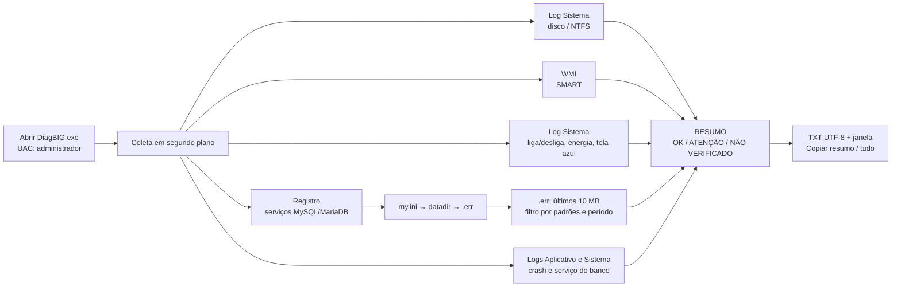

# DiagBIG

Coletor de logs de **disco**, **reinícios/energia** e **banco MySQL/MariaDB** para o suporte. Um único `.exe` para Windows: o N1 abre no PC do cliente, espera alguns segundos e cola o resumo no caso.

> Somente leitura: não altera nada no Windows, nos serviços, no log de eventos nem no banco, e não conecta no MySQL.

---

## Como executar (mini manual)

1. **Baixe** o `DiagBIG-v<versão>.zip` em [Releases](../../releases) e extraia. O zip traz só o `DiagBIG.exe` e o `MANUAL-DiagBIG.txt` (ou compile, veja abaixo).
2. **Copie** o `DiagBIG.exe` para qualquer pasta do PC do cliente e dê **dois cliques**. Aceite o pedido de administrador (UAC).
3. **Espere** a coleta, que começa sozinha e leva poucos segundos.
4. **Leia o RESUMO** no topo do texto. Cada linha mostra um de três estados:
   - `OK`: verificado e nada encontrado;
   - `ATENÇÃO`: encontrou algo, com quantidade e data da última ocorrência;
   - `NÃO VERIFICADO`: não deu para verificar, com o motivo escrito.
5. Clique em **Copiar resumo** (até 3.500 caracteres, para o comentário do caso) ou **Copiar tudo** (para o N2).

| Botão / opção | O que faz |
|---|---|
| Período 7 / 30 / 90 dias + **Coletar novamente** | Refaz a coleta com outro período (padrão: 30) |
| **Abrir TXT** / **Abrir pasta** | Abre o relatório salvo / a pasta com ele selecionado |
| **Ajuda (F1)** | Manual do N1 dentro do programa |
| `DiagBIG.exe --sem-janela [--dias 7\|30\|90]` | Gera só o TXT e sai (automação; código 0 = gravou) |

O relatório vai para `DiagBIG_relatorios\DiagBIG_<PC>_<aaaaMMdd_HHmmss>.txt`, ao lado do .exe (ou na Área de Trabalho). Ficam os 10 mais recentes de cada PC.

**Requisito:** .NET Framework 4.x, presente do Windows 7 SP1 (com .NET 4 instalado) ao Windows 11, que já traz o 4.8.

### Compilar (Ubuntu ou qualquer SO com .NET SDK 8)

```bash
dotnet test                                          # 80 testes da lógica (net8.0)
dotnet build src/DiagBIG/DiagBIG.csproj -c Release   # gera src/DiagBIG/bin/Release/net40/DiagBIG.exe
```

Não precisa de Windows, Visual Studio nem Mono: as referências do .NET Framework vêm do pacote `Microsoft.NETFramework.ReferenceAssemblies`.

---

## Por que existe

No suporte, a pergunta "o banco corrompeu por quê?" costuma ter três suspeitos: **disco falhando**, **queda de energia ou desligamento forçado** e **erro no próprio MySQL/MariaDB**. Coletar isso por acesso remoto, abrindo o Visualizador de Eventos, filtrando fontes e procurando o `.err` certo, leva tempo e depende de quem faz. O DiagBIG faz a mesma coleta sempre do mesmo jeito e devolve um texto pronto para colar no caso. Também ajuda quando o cliente diz que "não desligou o PC".

## Fluxo



Cada parte roda isolada: se uma falhar (sem permissão, log inexistente, WMI quebrado), ela vira `NÃO VERIFICADO` com o motivo e as outras seguem.

---

## Cada ponto, em detalhe

### 1. Disco / NTFS (log Sistema)

Equivale a "Filtrar log atual" no Visualizador de Eventos, só que automático.

- `EventLogReader` com **XPath filtrando nível e período na própria consulta**, sem ler o log inteiro.
- **Crítico + Erro** de qualquer fonte cujo nome **contenha** `disk`, `ntfs`, `volmgr`, `atapi`, `storahci`, `stornvme` ou `iastor`. O XPath do log de eventos não tem `contains()`, então a fonte é filtrada no código.
- **Avisos** da fonte `disk` com IDs **51, 52 e 153**, sinais clássicos de disco falhando.
- **SMART** via WMI (`root\wmi`, `MSStorageDriver_FailurePredictStatus`): `PredictFailure = True` → ATENÇÃO. Em VM, RAID e alguns NVMe não há suporte → `NÃO VERIFICADO`, sem quebrar. Também lista modelo e status dos discos (`Win32_DiskDrive`).

### 2. Reinícios e desligamentos

Uma consulta ao log Sistema alimenta dois blocos.

**Desligamentos inesperados** (deixam o resumo em ATENÇÃO):

| Evento | Significado |
|---|---|
| Kernel-Power **41** | Reiniciou sem desligar corretamente. O DiagBIG **interpreta os dados do evento**: `BugcheckCode ≠ 0` → **tela azul** (com o código); `PowerButtonTimestamp ≠ 0` → **botão de energia segurado**; tudo zerado → **provável queda/corte de energia, reset ou travamento** |
| EventLog **6008** | "O desligamento anterior às HH:MM foi inesperado": dá o horário da queda |
| BugCheck **1001** | Tela azul registrada |

**Linha do tempo de liga/desliga** (mais recente primeiro): `6005` ligou, `6006` desligou corretamente, `User32 1074` reinício/desligamento **solicitado, com usuário, processo e motivo** (ex.: Windows Update), `Kernel-Power 42` suspensão, `Power-Troubleshooter 1` voltou da suspensão. No resumo vira a linha `LIGA/DESLIGA`: inicializações, desligamentos corretos, solicitados, inesperados e "ligado desde" (`Win32_OperatingSystem.LastBootUpTime`).

> Com a Inicialização Rápida do Windows 8/10/11, "Desligar" vira hibernação e não gera 6005/6006. O relatório avisa isso.

### 3. Banco: achar o serviço e o `.err`

Funciona com **MariaDB**, **MySQL 5.x/8** (ex.: MySQL 5.1 em Arquivos de Programas) e **MySQL 4** (ex.: `C:\mysql`). O nome do serviço não importa.

1. Varre `HKLM\SYSTEM\CurrentControlSet\Services` e pega todo serviço cujo **executável do `ImagePath`** seja `mysqld.exe`, `mariadbd.exe` ou os do MySQL 4 (`mysqld-nt.exe`, `mysqld-max-nt.exe`, `mysqld-max.exe`, `mysqld-opt.exe`), com ou sem `.exe`. Pode haver mais de um.
2. Para cada serviço mostra nome, status (rodando/parado), tipo de inicialização e ImagePath.
3. Descobre o `.err`:

| Situação | Regra |
|---|---|
| `--defaults-file` no ImagePath (com ou sem aspas, `/` ou `\`) | Lê **só** esse arquivo, como o MySQL |
| Sem `--defaults-file` | Lê **todos** que existirem, na ordem do MySQL no Windows, e o último prevalece: `%WINDIR%\my.ini`/`my.cnf` (comum no MySQL 4), `C:\my.ini`/`my.cnf`, pasta base (pai da `bin`) e `data` |
| Seções lidas | `[mysqld]`, `[mariadb]`, `[mariadbd]`, `[server]` e variações com versão (`[mysqld-5.5]`, `[mariadb-10.4]`) |
| Chaves | `datadir`, `basedir`, `log-error` / `log_error` (aceita `-` e `_`, prefixo `loose-`, aspas, `\\`) |
| `log-error` relativo | Relativo à `datadir` |
| `log-error` sem extensão | Acrescenta `.err` |
| `log-error` não definido | `datadir\NOMEDOPC.err`; se não existir, `datadir\mysql.err` (padrão do MySQL 4) |
| Arquivo esperado não existe | Usa o `.err` **modificado mais recentemente** da datadir **e avisa qual leu** |

4. **Varredura de reserva**, sem busca recursiva, quando não há serviço ou o `.err` do serviço não foi achado. Em todas as unidades fixas procura `Program Files[ (x86)]\MariaDB*\data`, `Program Files\MySQL\MySQL Server*\data`, `ProgramData\MySQL\MySQL Server*\data` e **qualquer pasta na raiz da unidade** cuja `data` tenha a subpasta de sistema `mysql` (presente em toda datadir MySQL/MariaDB), seja qual for o nome da pasta.
5. O TXT diz como cada `.err` foi achado: **"pelo serviço X"** ou **"por varredura (sem serviço)"**.

**Caso real tratado:** o suporte renomeia o `.err` para `old_PC.err` com o banco rodando. O MariaDB continua gravando no arquivo renomeado até o serviço reiniciar. O DiagBIG lê o `old_`, avisa ("lido old_PC.err porque PC.err não existe") e, depois do reinício, avisa que existe "outro .err alterado no período, NÃO lido".

### 4. Leitura e filtro do `.err`

- Abre com `FileShare.ReadWrite | FileShare.Delete`: **não trava o banco**.
- Lê só os **últimos 10 MB** (há clientes com `.err` de centenas de MB) e descarta a primeira linha, que vem cortada.
- Encoding: tenta **UTF-8 estrito**; se houver byte inválido, usa **Windows-1252**.
- Datas no começo da linha, nos três formatos:

| Versão | Formato | Observação |
|---|---|---|
| MySQL 4 / 5.1 / 5.5 | `141022 10:00:00` / `141022  9:05:03` | Hora com 1 dígito; no MySQL 4 as linhas não têm `[ERROR]`, e os padrões pegam pelo texto |
| MariaDB | `2024-01-01 10:00:00` | Hora local |
| MySQL 8 | `2024-01-01T10:00:00.123456Z` | **UTC → convertido para hora local**; aceita também `-03:00` |

- Linha sem data **herda a data da anterior**. Linhas antes da primeira data (início cortado) são ignoradas, a menos que o arquivo não tenha data nenhuma.
- **Padrões** (sem diferenciar maiúsculas, lista editável): `[ERROR]`, `[FATAL]`, `corrupt`, `crashed`, `marked as crashed`, `Assertion failure`, `got exception`, `got signal`, `hit a bug`, `innodb_force_recovery`, `Database page corruption`, `Incorrect key file`, `Got error 1…` (126/127/134/145), `Operating system error`, `Out of memory`, `Aborting`, `crash recovery`, `Can't open`, `Unable to lock`, `No space left`, `Disk full`.
- No resumo, cada linha conta pelo **padrão mais específico** que casou (ex.: `marked as crashed` em vez de `[ERROR]`).
- **Crash** (`got exception`, `Assertion failure`, `got signal`): anexa as **~15 linhas seguintes** (stack/contexto). Para antes de uma linha datada mais de 1 minuto depois, e as linhas seguintes continuam sendo analisadas: nada é engolido.
- Agrupamento por **mensagem normalizada** (sem data, sem thread id, números longos e hex viram `#`).
- O cabeçalho informa **até quando a leitura alcança** ("leitura do .err cobre desde dd/mm/aaaa") e avisa se os 10 MB não chegam ao início do período.

### 5. Eventos do banco no Windows

- **Aplicativo:** Erro/Crítico de fontes contendo `mysql` ou `mariadb`, e `Application Error` 1000 que cite `mysqld.exe`/`mariadbd.exe` (crash do processo).
- **Sistema:** `Service Control Manager` 7000, 7009, 7023, 7024, 7031 e 7034 que citem algum serviço do banco (pelo nome ou nome de exibição): parou inesperadamente ou não iniciou.

### 6. O relatório (TXT)

- UTF-8 **com BOM** e quebras `\r\n`, para abrir certo no Bloco de Notas antigo.
- **Cabeçalho:** identificação (PC, Windows real com build, inclusive Windows 11; coleta, período, ligado desde, arquivo), unidades com espaço livre (marca "POUCO ESPAÇO"), cobertura dos logs ("log cobre desde…", com aviso se não cobre o período), aviso de **log limpo** (Eventlog 104) e cobertura de cada `.err`.
- **RESUMO** logo depois, uma linha por item. **Nunca mostra OK quando não deu para verificar.**
- **Seções numeradas**, cada bloco com **AGRUPAMENTO** (fonte + ID ou mensagem normalizada, contagem, primeira e última) e **ÚLTIMAS 30 OCORRÊNCIAS** com data/hora e mensagem completa. Sem nada no período, escreve "Nenhuma ocorrência encontrada no período" para o N1 não achar que falhou.

Trecho de exemplo (dados fictícios):

```text
RESUMO
------
  DISCO: ATENÇÃO — 3 eventos (disk 7: 3x), último em 10/11/2026 14:32
  SMART: NÃO VERIFICADO — SMART não suportado neste PC (comum em VM, RAID e alguns NVMe)
  DESLIGAMENTOS INESPERADOS: ATENÇÃO — 2 eventos (EventLog 6008: 1x, Kernel-Power 41: 1x), último em 10/11/2026 08:02
  LIGA/DESLIGA: ATENÇÃO — 1 inicialização, 1 desligamento correto, 1 solicitado(s) (User32 1074), 1 inesperado; ligado desde 10/11/2026 08:01
  BANCO (MariaDB): ATENÇÃO — 12 ocorrências (marked as crashed: 2x, Aborting: 1x, ...), última em 08/11/2026 02:14
  EVENTOS DO BANCO NO WINDOWS: OK — nenhuma ocorrência no período

==============================================================================
  2. REINÍCIOS E DESLIGAMENTOS
==============================================================================

>>> DESLIGAMENTOS INESPERADOS (KERNEL-POWER 41, EVENTLOG 6008, TELA AZUL)
[10/11/2026 08:01:50] Microsoft-Windows-Kernel-Power ID 41
    Interpretação: sem tela azul e sem botão de energia: provável QUEDA/CORTE DE ENERGIA, reset ou travamento total

>>> LINHA DO TEMPO DE LIGA/DESLIGA (MAIS RECENTE PRIMEIRO)
  10/11/2026 08:02:01  DESLIGAMENTO INESPERADO        EventLog 6008
                         O desligamento anterior do sistema às 19:44:10 em 09/11/2026 foi inesperado.
  10/11/2026 08:02:00  LIGOU (Windows iniciou)        EventLog 6005
  08/11/2026 22:00:05  DESLIGOU CORRETAMENTE          EventLog 6006
  08/11/2026 22:00:00  DESLIGAR/REINICIAR SOLICITADO  User32 1074
                         O processo C:\Windows\system32\winlogon.exe (CAIXA01) iniciou a reinicialização ... em nome do usuário CAIXA01\caixa
```

### 7. A janela

- Uma janela só, **montada 100% em código** (sem Designer e sem `.resx`, para compilar no Linux sem dor).
- A coleta roda numa **thread em segundo plano**: a janela não trava, e a barra de status mostra a etapa atual.
- Caixa de texto grande, somente leitura, fonte monoespaçada (Consolas).
- "Copiar" usa `Clipboard.SetDataObject` com **retentativas**, porque em acesso remoto a área de transferência costuma estar ocupada. Mostra "Copiado!".
- **Ajuda (F1)** mostra o manual do N1 ([`docs/MANUAL.txt`](docs/MANUAL.txt)), embutido no .exe.
- Logo e ícone embutidos (ícone com 7 tamanhos, de 16 a 256).

### 8. Pasta de relatórios

Grava em `DiagBIG_relatorios\` (ao lado do .exe ou na Área de Trabalho) e mantém os **10 mais recentes por PC**, para permitir comparar antes e depois sem acumular arquivos. Só apaga arquivos com o próprio padrão de nome `DiagBIG_<PC>_<aaaaMMdd_HHmmss>.txt`; qualquer outro arquivo na pasta é ignorado.

---

## Garantias de projeto

| Garantia | Como |
|---|---|
| Somente leitura | Só `EventLogReader`, leitura de registro, WMI de consulta e leitura de arquivos compartilhada. A única escrita é o próprio TXT e a limpeza dos TXT antigos do DiagBIG |
| Não trava o banco | `.err` aberto com `FileShare.ReadWrite \| Delete`, só o final |
| Falha isolada | Cada parte em `try/catch` próprio; o erro vira `NÃO VERIFICADO: motivo` naquela seção |
| Sem falso OK | `OK` só quando todos os blocos daquela linha foram verificados e nada foi achado |
| Leve | Filtros de nível e período no XPath, sem busca recursiva no disco, teto de 20.000 eventos por consulta |
| Um arquivo só | Sem instalador, sem DLL, sem `.config`, sem internet |

## Decisões técnicas

| Decisão | Motivo |
|---|---|
| **C# WinForms, .NET Framework 4.0 (`net40`)** | Roda em qualquer 4.x, do Windows 7 SP1 ao 11, sem instalar nada no Windows 10/11 |
| **Projeto SDK-style + `Microsoft.NETFramework.ReferenceAssemblies`** | Compila no Ubuntu com `dotnet build` |
| **Interface em código, sem `.resx`** | Evita os problemas de geração de recursos fora do Windows |
| **Recursos embutidos via `EmbeddedResource`** (logo, manual) | Continua um único `.exe` |
| **Manifesto `requireAdministrator`** + `supportedOS` do Win7 ao Win11 | Log de eventos/SMART exigem admin; versão do Windows correta |
| **AnyCPU sem Prefer32Bit** | Roda 64 bits em Windows 64 bits (registro e WMI sem redirecionamento) |
| **Lógica separada em `Core/`**, sem dependência do Windows | Testável no Linux; `WinPath` próprio porque `System.IO.Path` no Linux usa `/` |

## Estrutura

```text
src/DiagBIG/
  Core/        lógica pura (testada): Config, ImagePathParser, MyIniParser, DbPathResolver,
               ErrTailReader, ErrLogAnalyzer, PowerEvents, Grouping, ReportBuilder, WinPath
  Windows/     Collector (orquestra), EventLogs, DbDiscovery, SystemInfo (SMART, boot, unidades)
  UI/          MainForm, HelpForm
  Resources/   diagbig.ico
  app.manifest
tests/DiagBIG.Tests/   xUnit em net8.0 compilando os mesmos arquivos de Core/
amostras/              .err falsos (MySQL 4, MySQL 5.1, MariaDB 10.4, MySQL 8) e my.ini de exemplo
docs/MANUAL.txt        manual do N1 (botão Ajuda)
TESTE-NA-VM.txt        roteiro de teste manual no Windows
```

## Testes

- **80 testes** xUnit (`dotnet test`) sobre a lógica de `Core/`: ImagePath (inclusive executáveis do MySQL 4 e `mysqld` sem `.exe` do 5.1), my.ini (WinMySQLadmin do MySQL 4, instalador do 5.1, ordem de leitura), regras do `.err` (inclusive `mysql.err`), datas nos três formatos (inclusive UTC → local), herança de data, contexto de crash, período, agrupamento, resumo de três estados, montagem do TXT, limite do resumo, leitura do final do arquivo com ele aberto por outro processo, UTF-8/Windows-1252, eventos de energia, retenção de relatórios e o manual citando todos os itens do RESUMO.
- As **amostras** em `amostras/` são usadas diretamente pelos testes.
- O que depende do Windows (EventLog, WMI, registro, janela) é testado à mão com o roteiro [`TESTE-NA-VM.txt`](TESTE-NA-VM.txt): disco com `Write-EventLog`, `.err` com linhas injetadas, `.err` renomeado/ausente, reinício normal e desligamento forçado da VM, modo sem janela e botões.

## Como estender

Tudo o que é ajustável está em [`src/DiagBIG/Core/Config.cs`](src/DiagBIG/Core/Config.cs): fontes de disco, IDs, executáveis do banco, pastas da varredura, padrões do `.err`, linhas de contexto de crash, tamanho lido do `.err`, quantidade de ocorrências detalhadas, limite do resumo e retenção de relatórios.

## Limitações conhecidas

- **SMART** não funciona em VM, em boa parte dos RAIDs e em alguns NVMe (fica `NÃO VERIFICADO`, como esperado).
- Com **Inicialização Rápida**, "Desligar" não aparece como desligamento na linha do tempo (é hibernação).
- O `.err` é lido só nos **últimos 10 MB**; o cabeçalho mostra até onde a leitura alcançou.
- Se o log do Windows foi sobrescrito ou limpo, o período anterior não existe mais; o relatório avisa.
